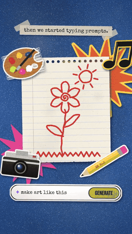
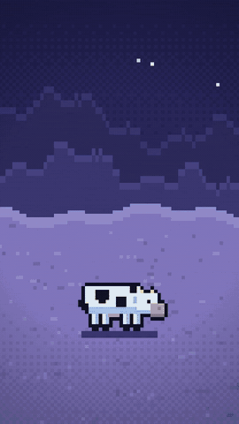
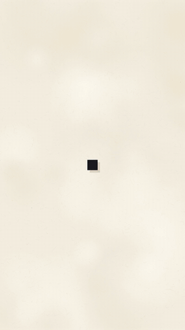

# Alkara Skill

**Made with Alkara Skill**. Every frame below was drawn in code. Click a preview to watch the full video with sound.

| Made by Humans | Take Me to Your Cow | Pixel Launch |
|:---:|:---:|:---:|
|  |  |  |
| Paper-collage reel · 50 s | Pixel-art game promo · 25 s | Pixel icons to rocket launch · 15 s |

---

A Claude skill that turns reference images/videos and a rough idea into a finished, share-ready animated MP4: every frame drawn in JavaScript on a canvas, rendered with a local Chrome/Edge via puppeteer-core, encoded with ffmpeg, and scored with synthesized sound.

## Install
Copy the `SKILL.md` in this repo into a folder named `alkara-skill` in your Claude skills directory, or upload it as a skill in Claude.

## Use
Share references plus an idea, e.g. *"Make a 50 sec reel in a paper collage style about how AI is affecting creativity."*
Defaults: 15 s, 9:16 (1080×1920), generated soundtrack.
